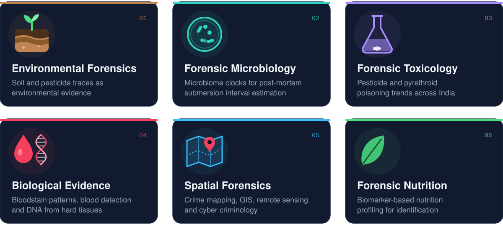

  

  
  
  
  

## 🔬 About me

I'm a forensic scientist and educator working where **environmental science, biology and spatial data meet the crime scene**. My research asks one question in many forms: *how can a trace (a grain of soil, a microbe, a pesticide residue, a bloodstain) link a person, an object or a body to a place and a time?*

I teach forensic science at Kristu Jayanti (Deemed to be University), coordinate undergraduate research projects, and mentor students from research idea to publication.

## 🧭 Research areas

## 🗂️ Case files

## 📊 Evidence board

## 📚 Publications

<b>🌍 Environmental forensics &amp; toxicology</b>

 

- **Pesticide Contamination in Indian Agricultural and Residential Areas: A Comparative Assessment of Health Risks and Environmental Impacts** · *Indian J Forensic Med Pathol*, 2026 · [DOI ↗](https://doi.org/10.21088/ijfmp.0974.3383.19226.14) · `Lead & corresponding author`
- **A Review on Frequency and Prevalence of Pyrethroid Poisoning in India (2020–2025)** · *Int J Research Culture and Society*
- **A Review on Frequency and Prevalence of Pyrethroid Poisoning in India** · *Int J Research Culture and Society*

<b>🦠 Forensic microbiology &amp; biomarkers</b>

 

- **Aquatic Plant–Associated Microbiomes as Biological Clocks for Postmortem Submersion Interval Estimation in Tropical Freshwater: A Proposed Framework** · *Int J Medical Toxicology and Forensic Medicine*, 2026 · [DOI ↗](https://doi.org/10.22037/ijmtfm.v16.52454)
- **Forensic Nutrition Profiling: A Novel Biomarker-Based Framework** · *Indian Journal of Natural Sciences*, 2026 · `Accepted` `Corresponding author`

<b>🩸 Biological evidence</b>

 

- **A Scoping Review on DNA Extraction Techniques in Hard Tissues** · *Indian Journal of Biology*, 2025 · [DOI ↗](https://doi.org/10.21088/ijb.2394.1391.12225.2)
- **Evaluating Benzidine for Rapid Detection of Blood Remnants on Fabrics after Multiple Washing Cycles** · *Indian J Modern Research and Reviews*, 2024 · [DOI ↗](https://doi.org/10.5281/zenodo.12584278)
- **Advances in 3D Imaging Technologies for Bloodstain Pattern Analysis: A Contemporary Forensic Review** · *Indian Journal of Natural Sciences*, 2026

<b>🗺️ Spatial forensics &amp; criminology</b>

 

- **Crime Mapping and Law Enforcement: A Review on the Role of Police Station Distribution in Crime Prevention** · *Romanian Journal of Legal Medicine*, 2026 · [DOI ↗](https://doi.org/10.4323/rjlm.2026.47) · `Scopus-indexed`
- **Integrating Remote Sensing and Artificial Intelligence: A Review of Technological Innovations in Wildlife Crime Detection** · *Uttar Pradesh Journal of Zoology*, 2024 · [DOI ↗](https://doi.org/10.56557/upjoz/2024/v45i234683)
- **A Review on Application of Lifestyle-Routine Activity Theory in Cyber Criminology** · *International Journal of Forensic Sciences* · [DOI ↗](https://doi.org/10.23880/ijfsc-16000401)

## 🧪 Lab toolkit

  
  
  
  
  
  
  
  

## 🎓 Teaching & mentoring

- 👩‍🏫 Teach forensic science courses, including forensic biology, serology and pharmacology
- 🧑‍🔬 Coordinate BSc undergraduate research projects
- ✍️ Mentor students from research idea to published paper

## 📫 Let's collaborate

Open to research collaborations in **environmental forensics, forensic microbiology and spatial forensics**.

📧 **[riyaraj.ca@kristujayanti.com](mailto:riyaraj.ca@kristujayanti.com)**
<!-- Add your links here when ready, e.g.:
🔗 [ORCID](https://orcid.org/XXXX-XXXX-XXXX-XXXX) · [Google Scholar](https://scholar.google.com/citations?user=XXXX) · [LinkedIn](https://linkedin.com/in/XXXX)
-->

